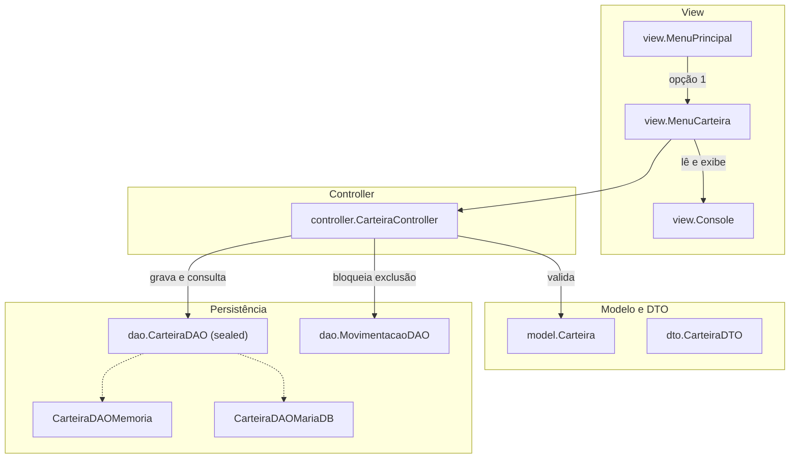
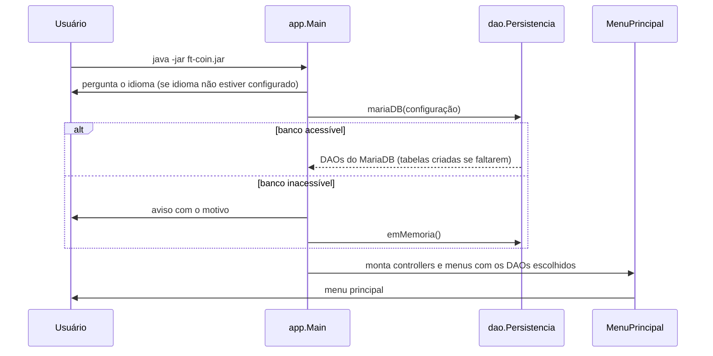
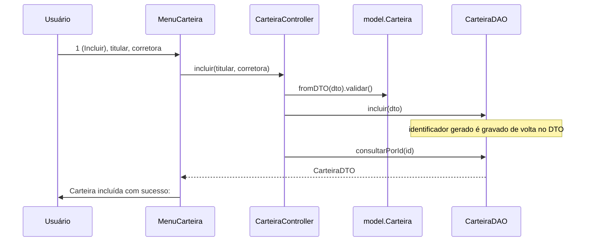

# Fluxo de Carteira (FT_Coin)

Como o cadastro de carteiras funciona no código em `src/main/java`.

---

## 1. Arquitetura

O fluxo segue **MVC + DTO + DAO**. A view só conversa com o controller; o controller valida pelo
modelo e grava pelo DAO, sem saber se a persistência é em memória ou no MariaDB.

| Componente | Responsabilidade |
| ---------- | ---------------- |
| [MenuCarteira](../src/main/java/view/MenuCarteira.java) | Opções de incluir, consultar, editar e excluir; lê os dados e exibe o resultado |
| [Menu](../src/main/java/view/Menu.java) | Base de todos os menus: numera as opções, repete até o 0 e mostra os erros sem encerrar a aplicação |
| [CarteiraController](../src/main/java/controller/CarteiraController.java) | Valida o identificador, monta o DTO, valida pelo modelo e chama o DAO |
| [Carteira](../src/main/java/model/Carteira.java) | Regras da entidade: titular e corretora obrigatórios |
| [CarteiraDAO](../src/main/java/dao/CarteiraDAO.java) | Interface selada; só `CarteiraDAOMemoria` e `CarteiraDAOMariaDB` a implementam |
| [Persistencia](../src/main/java/dao/Persistencia.java) | Cria o conjunto de DAOs de memória ou do MariaDB |

---

## 2. Inicialização

Os controllers recebem as interfaces dos DAOs no construtor, então trocar a persistência não altera
controller nem view.

---

## 3. Operações

| Opção | O que acontece | Erros possíveis |
| ----- | -------------- | --------------- |
| **1. Incluir** | Lê titular e corretora, valida e grava. O DAO gera o identificador (na memória, o menor livre; no MariaDB, `AUTO_INCREMENT`) | Titular ou corretora vazios |
| **2. Consultar** | Lê o identificador e mostra `#id - titular (corretora: X)` | Identificador ≤ 0 ou inexistente |
| **3. Editar** | Mostra os dados atuais, lê os novos e grava | Os mesmos do incluir e do consultar |
| **4. Excluir** | Mostra a carteira, pede confirmação (S/N) e exclui | Carteira com movimentações (o histórico não pode ser perdido) |

---

## 4. Erros

Toda regra violada lança `AppException` com a **chave** da mensagem e os argumentos. O `Menu` captura a
exceção e exibe `Erro: <mensagem>` no idioma escolhido, e o usuário volta ao submenu. Falhas do banco
chegam como `PersistenciaException` (subclasse de `AppException`) com o erro original como causa.

---

## 5. Arquivos

| Camada | Arquivos |
| ------ | -------- |
| View | `view/MenuCarteira.java`, `view/Menu.java`, `view/Console.java`, `view/Formatador.java` |
| Controller | `controller/CarteiraController.java` |
| Modelo e DTO | `model/Carteira.java`, `dto/CarteiraDTO.java` |
| DAO | `dao/CarteiraDAO.java`, `dao/CarteiraDAOMemoria.java`, `dao/CarteiraDAOMariaDB.java` |
| Textos | `i18n/mensagens_*.properties` (chaves `carteira.*` e `erro.carteira.*`) |
| Testes | `CarteiraControllerTest`, `PersistenciaContrato` (memória e MariaDB) |
