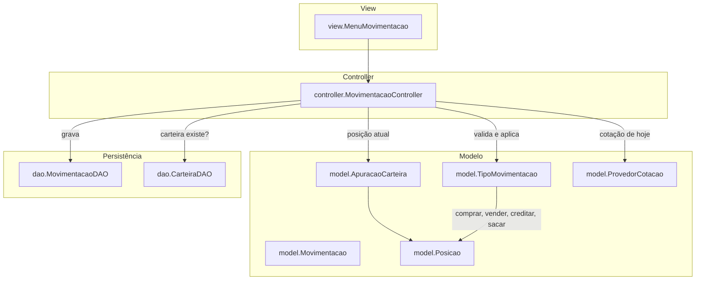
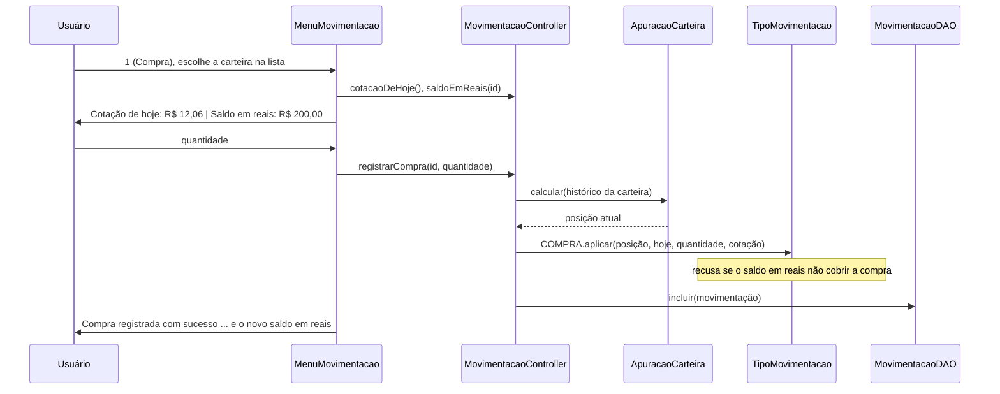

# Fluxo de Movimentação (FT_Coin)

Como compras, vendas, créditos e saques funcionam no código em `src/main/java`.

---

## 1. Arquitetura

| Componente | Responsabilidade |
| ---------- | ---------------- |
| [MenuMovimentacao](../src/main/java/view/MenuMovimentacao.java) | Pede a escolha da carteira na lista, mostra a cotação de hoje e o saldo em reais, lê a quantidade ou o valor |
| [MovimentacaoController](../src/main/java/controller/MovimentacaoController.java) | Registra a operação na data do sistema (`Clock`), à cotação do dia |
| [TipoMovimentacao](../src/main/java/model/TipoMovimentacao.java) | Enum polimórfico: cada tipo (`COMPRA`, `VENDA`, `CREDITO`, `SAQUE`) sabe como altera a posição |
| [Posicao](../src/main/java/model/Posicao.java) | FTCoins, custo médio, totais e saldo em reais; recusa operações sem saldo |
| [ApuracaoCarteira](../src/main/java/model/ApuracaoCarteira.java) | Reconstrói a posição atual a partir do histórico da carteira |

---

## 2. Registro de uma operação

A operação é **aplicada à posição atual antes de ser gravada**. Assim valem exatamente as mesmas
regras da apuração, e uma operação inválida nunca chega ao banco.

---

## 3. Regras de cada tipo

| Tipo | Código | Quantidade é | Efeito na posição | Recusada quando |
| ---- | ------ | ------------ | ----------------- | --------------- |
| Compra | `C` | FTCoins | soma FTCoins, recalcula o custo médio, debita `qtd × cotação` do saldo em reais | o saldo em reais não cobre o valor (só para compras a partir de `credito.vigencia`) |
| Venda | `V` | FTCoins | subtrai FTCoins, gera resultado `qtd × (cotação − custo médio)`, credita o valor no saldo em reais | a quantidade excede o saldo de FTCoins |
| Crédito | `D` | reais | soma ao saldo em reais | — |
| Saque | `S` | reais | subtrai do saldo em reais | o valor excede o saldo em reais |

Custo médio na compra: `(custoMédio × saldo + qtd × cotação) / (saldo + qtd)`. A venda não altera o
custo médio.

**Vigência do crédito.** Compras com data anterior a `credito.vigencia` (em `ftcoin.properties`) foram
feitas antes de o saldo em reais existir, então não mexem nele. Isso preserva o histórico antigo, que
não teria saldo para justificar as compras.

**Data e cotação.** O usuário não informa data nem cotação: a data é a do sistema e a cotação vem do
Oráculo (ver [fluxo-oraculo.md](fluxo-oraculo.md)). Isso impede vendas retroativas que invalidariam o
histórico.

---

## 4. Erros

| Situação | Mensagem (pt) |
| -------- | ------------- |
| Nenhuma carteira cadastrada | Nenhuma carteira cadastrada. Inclua uma em Carteira > Incluir carteira. |
| Quantidade ≤ 0 ou texto inválido | Quantidade deve ser maior que zero. / Valor decimal inválido: X. |
| Venda acima do saldo | A venda de X FTCoins excede o saldo de Y FTCoins. |
| Compra ou saque sem saldo em reais | Saldo em reais insuficiente para a compra: disponível R$ X, necessário R$ Y. |
| Banco indisponível | Erro ao incluir a movimentação: (erro do driver) |

Em qualquer caso nada é gravado e o usuário volta ao menu.

---

## 5. Arquivos

| Camada | Arquivos |
| ------ | -------- |
| View | `view/MenuMovimentacao.java` |
| Controller | `controller/MovimentacaoController.java` |
| Modelo | `model/TipoMovimentacao.java`, `model/Posicao.java`, `model/Movimentacao.java`, `model/ApuracaoCarteira.java` |
| DAO | `dao/MovimentacaoDAO.java`, `dao/MovimentacaoDAOMemoria.java`, `dao/MovimentacaoDAOMariaDB.java` |
| Testes | `MovimentacaoControllerTest`, `ApuracaoCarteiraTest` |
