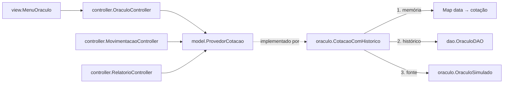

# Fluxo de Oráculo (FT_Coin)

De onde vêm as cotações e como elas são consultadas.

---

## 1. Arquitetura

O resto da aplicação só conhece a interface `ProvedorCotacao` (`cotacaoEm(data)`). Hoje a cotação é
**simulada**; quando a API do Oráculo existir, basta outra implementação da interface.



| Componente | Responsabilidade |
| ---------- | ---------------- |
| [OraculoSimulado](../src/main/java/oraculo/OraculoSimulado.java) | Calcula a cotação de um dia pela fórmula da planilha de apuração |
| [CotacaoComHistorico](../src/main/java/oraculo/CotacaoComHistorico.java) | Decorator: grava no `OraculoDAO` cada cotação obtida da fonte e responde pelo registro nas consultas seguintes |
| [ProvedorCotacao](../src/main/java/model/ProvedorCotacao.java) | Contrato da cotação por data; `ultimaCotacaoAte(data)` volta até 31 dias procurando a mais recente |
| [OraculoController](../src/main/java/controller/OraculoController.java) | Cotação de hoje, de uma data e de um período (até 366 dias) |

---

## 2. Cotação simulada

```
cotação     = base + flutuação + valorização
valorização = valorizacaoInicial + fatorValorizacao · ln(n)    (n = 1 na data inicial)
flutuação   = sorteio uniforme em [-amplitude, +amplitude)
```

- A flutuação usa uma semente derivada da data, então **a cotação de um dia é sempre a mesma**.
- O resultado é arredondado para 2 casas.
- Não há cotação antes de `oraculo.dataInicial` nem depois de hoje.
- Os parâmetros ficam nas chaves `oraculo.*` do `ftcoin.properties`. A configuração é recusada se
  permitir cotação ≤ 0 (`base + valorizacaoInicial - amplitude ≤ 0`).

**Por que gravar o histórico?** Uma cotação usada numa movimentação não pode mudar depois, senão a
apuração do passado mudaria. Com o `CotacaoComHistorico`, a primeira consulta de uma data grava a
cotação, e as seguintes leem o que foi gravado, mesmo que a fonte seja trocada pela API real. O mapa em
memória evita ir ao banco mais de uma vez por data.

---

## 3. Menu

| Opção | O que faz | Erros possíveis |
| ----- | --------- | --------------- |
| **1. Cotação de hoje** | Mostra a cotação da data do sistema | — |
| **2. Consultar por data** | Lê uma data no formato do idioma (`dd/MM/yyyy` em pt/es, `MM/dd/yyyy` em en) | Data inválida ou inexistente (31/02), anterior à data inicial ou futura |
| **3. Listar por período** | Lista a cotação de cada dia entre duas datas | Data final antes da inicial, período acima de 366 dias |

O usuário **não cadastra** cotações: elas sempre vêm do Oráculo.

---

## 4. Arquivos

| Camada | Arquivos |
| ------ | -------- |
| View | `view/MenuOraculo.java` |
| Controller | `controller/OraculoController.java` |
| Oráculo | `oraculo/OraculoSimulado.java`, `oraculo/CotacaoComHistorico.java`, `model/ProvedorCotacao.java` |
| DAO | `dao/OraculoDAO.java`, `dao/OraculoDAOMemoria.java`, `dao/OraculoDAOMariaDB.java` |
| Testes | `OraculoSimuladoTest`, `CotacaoComHistoricoTest`, `ProvedorCotacaoTest`, `OraculoControllerTest` |
