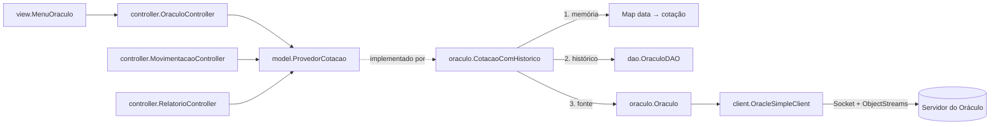

# Fluxo de Oráculo (FT_Coin)

De onde vêm as cotações e como elas são consultadas.

---

## 1. Arquitetura

O resto da aplicação só conhece a interface `ProvedorCotacao` (`cotacaoEm(data)`). A cotação vem do
servidor do Oráculo, consultado pelo cliente de rede `client.OracleSimpleClient`.

| Componente | Responsabilidade |
| ---------- | ---------------- |
| [Oraculo](../src/main/java/oraculo/Oraculo.java) | Pede a cotação de um dia ao servidor e converte a resposta em `double` |
| [OracleSimpleClient](../src/main/java/client/OracleSimpleClient.java) | Abre a conexão, envia `NetworkRequest` e lê `NetworkResponse` (pacote `network`) |
| [CotacaoComHistorico](../src/main/java/oraculo/CotacaoComHistorico.java) | Decorator: grava no `OraculoDAO` cada cotação obtida da fonte e responde pelo registro nas consultas seguintes |
| [ProvedorCotacao](../src/main/java/model/ProvedorCotacao.java) | Contrato da cotação por data; `ultimaCotacaoAte(data)` volta até 31 dias procurando a mais recente |
| [OraculoController](../src/main/java/controller/OraculoController.java) | Cotação de hoje, de uma data e de um período (até 366 dias) |

---

## 2. Cotação do servidor

`oraculo.Oraculo` monta um `NetworkRequest` com grupo, senha e a data pedida, envia pelo socket e
lê a `NetworkResponse`. A conexão é aberta a cada consulta e não há tempo limite: um servidor que não responde trava a consulta.

- Data futura: não vai ao servidor; responde "não há cotação para a data futura".
- Data sem cotação no servidor (`exchangeRates` vazio ou sem a data pedida): `erro.cotacao.naoEncontrada`.
  É uma falha de negócio comum, então `ultimaCotacaoAte` volta para o dia anterior.
- Conexão recusada ou interrompida, resposta inválida ou `errorMessage` do servidor: `OraculoIndisponivelException`. Essa exceção
  interrompe `ultimaCotacaoAte`, para que uma queda do servidor não vire "sem cotação" em 31 dias.
- Grupo e senha vêm de `oraculo.grupo` e `oraculo.senha`, que devem ficar em `ftcoin.local.properties`.
  Endereço em `oraculo.host` e `oraculo.porta`.

**Por que gravar o histórico?** Uma cotação usada numa movimentação não pode mudar depois, senão a
apuração do passado mudaria. Com o `CotacaoComHistorico`, a primeira consulta de uma data grava a
cotação na tabela `COTACAO` (criada pelo projeto; no MariaDB), e as seguintes leem o que foi gravado,
inclusive com o servidor do Oráculo fora do ar. O mapa em memória evita ir ao banco mais de uma vez por data.

---

## 3. Menu

| Opção | O que faz | Erros possíveis |
| ----- | --------- | --------------- |
| **1. Cotação de hoje** | Mostra a cotação da data do sistema | — |
| **2. Consultar por data** | Lê uma data no formato do idioma (`dd/MM/yyyy` em pt/es, `MM/dd/yyyy` em en) | Data inválida ou inexistente (31/02), anterior à data inicial ou futura |
| **3. Listar por período** | Lista a cotação de cada dia entre duas datas | Data final antes da inicial, período acima de 366 dias |

O usuário **não cadastra** cotações: elas sempre vêm do Oráculo.

---

## 4. Arquivos

| Camada | Arquivos |
| ------ | -------- |
| View | `view/MenuOraculo.java` |
| Controller | `controller/OraculoController.java` |
| Oráculo | `oraculo/Oraculo.java`, `oraculo/CotacaoComHistorico.java`, `model/ProvedorCotacao.java` |
| Cliente de rede | `client/OracleSimpleClient.java`, `network/NetworkRequest.java`, `network/NetworkResponse.java`, `network/ExchangeRate.java` |
| DAO | `dao/OraculoDAO.java`, `dao/OraculoDAOMemoria.java`, `dao/OraculoDAOMariaDB.java` |
| Testes | `OraculoTest` (servidor falso no loopback), `CotacaoComHistoricoTest`, `ProvedorCotacaoTest`, `OraculoControllerTest` |
