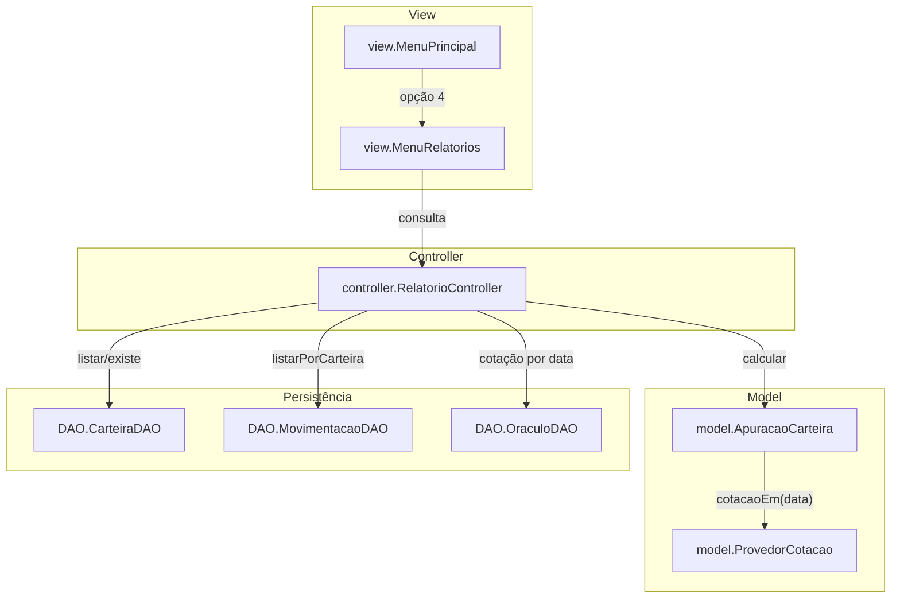
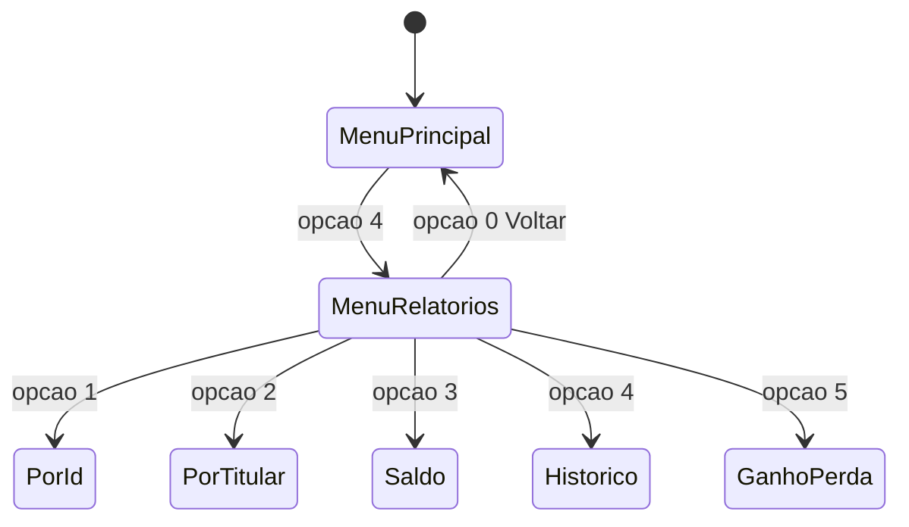
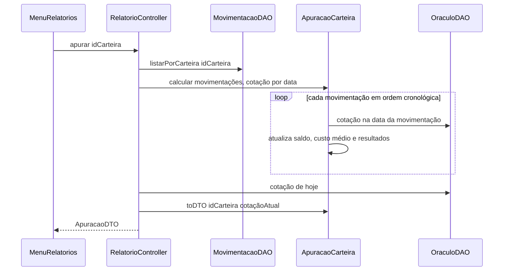

# Fluxo de Relatórios (FT_Coin)

Este documento descreve o fluxo de **Relatórios**: listagens de carteiras, saldo, histórico de movimentação e a apuração de **ganho/perda** por carteira, valorizada a **custo médio** e a **mercado** com as cotações do Oráculo.

---

## 1. Visão geral

O `RelatorioController` é somente leitura. Ele reúne os dados dos DAOs e entrega à regra de negócio (`ApuracaoCarteira`, no model), que calcula a posição e os resultados da carteira.



### Papel de cada componente

| Componente | Arquivo | Responsabilidade |
|------------|---------|------------------|
| **MenuRelatorios** | [src/main/java/view/MenuRelatorios.java](../src/main/java/view/MenuRelatorios.java) | Submenu de relatórios; lê IDs, formata e exibe resultados |
| **RelatorioController** | [src/main/java/controller/RelatorioController.java](../src/main/java/controller/RelatorioController.java) | Listagens ordenadas e `apurar(id)`, que monta a apuração da carteira |
| **ApuracaoCarteira** | [src/main/java/model/ApuracaoCarteira.java](../src/main/java/model/ApuracaoCarteira.java) | Regra de negócio: custo médio, saldo, resultado operacional e resultados a custo médio e a mercado |
| **ProvedorCotacao** | [src/main/java/model/ProvedorCotacao.java](../src/main/java/model/ProvedorCotacao.java) | Contrato que informa a cotação de uma data; isola o cálculo da origem das cotações |
| **ApuracaoDTO** / **LinhaApuracaoDTO** | [src/main/java/dto/](../src/main/java/dto/) | Transportam o resultado da apuração e cada linha do histórico até a view |
| **CarteiraDAO** | [src/main/java/dao/CarteiraDAO.java](../src/main/java/dao/CarteiraDAO.java) | `listarTodas()`, `existe()` |
| **MovimentacaoDAO** | [src/main/java/dao/MovimentacaoDAO.java](../src/main/java/dao/MovimentacaoDAO.java) | `listarPorCarteira()` |
| **OraculoDAO** | [src/main/java/dao/OraculoDAO.java](../src/main/java/dao/OraculoDAO.java) | `consultarPorData()`, `existe()` |

---

## 2. Navegação no menu



---

## 3. Operações

| Opção | Método do controller | O que é exibido |
|-------|----------------------|-----------------|
| 1. Buscar por identificador | `listarPorIdentificador()` | Carteiras ordenadas pelo `id` |
| 2. Buscar por titular | `listarPorTitular()` | Carteiras ordenadas pelo `nomeTitular` (case-insensitive) |
| 3. Saldo atual | `apurar(id)` | Quantidade em FTCoins, custo médio, valor a custo médio, cotação atual e valor a mercado |
| 4. Histórico de movimentação | `apurar(id)` | Uma linha por movimentação: cotação, valor, saldo em quantidade, custo médio e resultado da operação |
| 5. Ganhos e perdas | `apurar(id)` por carteira | Total comprado e vendido, resultado operacional e resultados a custo médio e a mercado, com percentuais |

---

## 4. Apuração por custo médio

As movimentações são percorridas **em ordem cronológica** (empates na mesma data seguem a ordem de registro). A lógica segue a planilha de simulação de apuração:

| Operação | Quantidade | Custo médio | Resultado da operação |
|----------|-----------|-------------|-----------------------|
| **Compra** | `saldo + qtd` | `(custoMédio × saldo + qtd × cotação) / (saldo + qtd)` | — |
| **Venda** | `saldo − qtd` | não muda | `qtd × (cotação − custoMédio)` |

Quando o saldo chega a zero, o custo médio é zerado e a próxima compra o recomeça na cotação do dia.

Resumo exibido na opção 5 (percentuais sobre o total comprado):

```
resultadoOperacional  = totalVendido − totalComprado
saldoACustoMedio      = saldo × custoMédio
resultadoCustoMedio   = resultadoOperacional + saldoACustoMedio     (= soma dos resultados das vendas)
resultadoMercado      = resultadoOperacional + saldo × cotação(hoje)
```

O resultado a mercado indica quanto a carteira ganharia ou perderia se todo o saldo fosse vendido hoje.



A opção 5 do menu percorre todas as carteiras e apura cada uma; o erro de uma carteira não impede a exibição das demais.

### Pré-condição: cotação de hoje

A valoração a mercado usa a cotação da data atual. Se ela não estiver cadastrada, `apurar()` lança `AppException` orientando o cadastro no menu Oráculo. As datas das movimentações já têm cotação garantida, pois isso é validado no momento do registro.

---

## 5. Tratamento de erros

| Origem | Exemplo | Quem lança | Quem captura |
|--------|---------|------------|--------------|
| Identificador inválido | id ≤ 0 | `RelatorioController` | `MenuRelatorios` |
| Carteira inexistente | id não cadastrado | `RelatorioController` | `MenuRelatorios` |
| Sem cotação para uma data | falta cotação de hoje ou de uma data de movimentação | `RelatorioController` | `MenuRelatorios` (por carteira na opção 5) |
| Histórico inconsistente | venda maior que o saldo disponível na data | `ApuracaoCarteira` | `MenuRelatorios` |
| Entrada numérica inválida | "abc" como ID | `Main.lerInteiro()` | `MenuRelatorios` |
