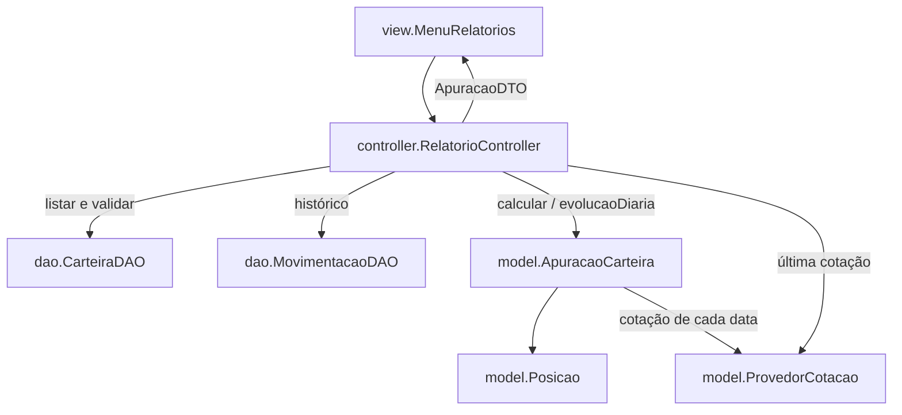
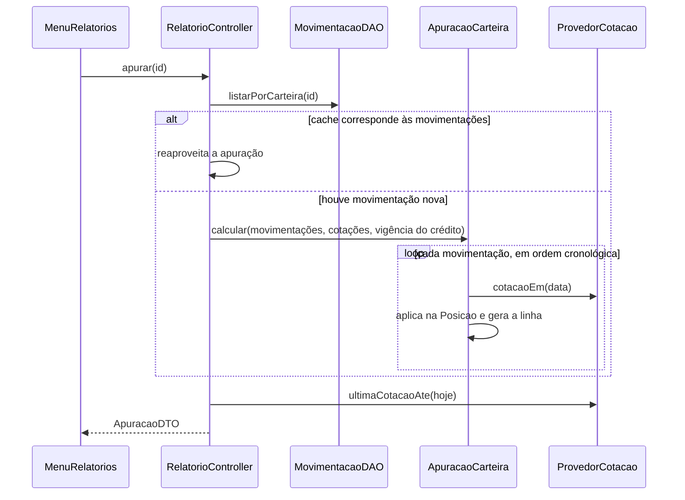

# Fluxo de Relatórios (FT_Coin)

Listagens, saldo, histórico, evolução diária e apuração de ganho/perda por carteira, valorizada a
**custo médio** e a **mercado**. Os cálculos reproduzem a planilha de apuração de referência
(`ApuracaoCarteiraPlanilhaTest` confere as 16 operações, o resumo e os 30 dias).

---

## 1. Arquitetura

O `RelatorioController` só lê dados. A regra de cálculo fica no modelo (`ApuracaoCarteira` e `Posicao`).



| Componente | Responsabilidade |
| ---------- | ---------------- |
| [MenuRelatorios](../src/main/java/view/MenuRelatorios.java) | Lê a carteira, formata as tabelas e o resumo, imprime o saldo em arquivo |
| [RelatorioController](../src/main/java/controller/RelatorioController.java) | Listagens ordenadas, `apurar(id)` e `evolucaoDiaria(id)`; guarda a apuração em cache |
| [ApuracaoCarteira](../src/main/java/model/ApuracaoCarteira.java) | Aplica as movimentações em ordem cronológica e gera o histórico e a evolução diária |
| [ApuracaoDTO](../src/main/java/dto/ApuracaoDTO.java) | Record com o resumo, as linhas do histórico (`Linha`) e os dias da evolução (`Dia`) |

---

## 2. Menu

| Opção | Conteúdo |
| ----- | -------- |
| **1 e 2. Listar carteiras** | Por identificador ou por titular (sem diferenciar maiúsculas) |
| **3. Saldo atual** | FTCoins, custo médio, valor a custo médio, cotação atual, valor a mercado e saldo em reais; opção de gravar em `saldo-carteira-<id>-<data>.txt` |
| **4. Histórico** | Uma linha por operação, com a posição logo após ela e o resultado de cada venda |
| **5. Evolução diária** | Uma linha por dia, da primeira operação até hoje, como na planilha |
| **6. Ganhos e perdas** | Resumo de todas as carteiras com as frases da planilha; o erro de uma carteira não impede as demais |

---

## 3. Cálculos

Por operação (ver [fluxo-movimentacao.md](fluxo-movimentacao.md)):

| Operação | Saldo de FTCoins | Custo médio | Resultado |
| -------- | ---------------- | ----------- | --------- |
| Compra | `saldo + qtd` | `(custoMédio × saldo + qtd × cotação) / (saldo + qtd)` | — |
| Venda | `saldo − qtd` | não muda | `qtd × (cotação − custoMédio)` |

Resumo (percentuais sobre o total comprado):

```
resultadoOperacional = totalVendido − totalComprado
saldoACustoMedio     = saldo × custoMédio
resultadoCustoMedio  = resultadoOperacional + saldoACustoMedio
resultadoMercado     = resultadoOperacional + saldo × última cotação
```

A **última cotação** é a mais recente até hoje (`ProvedorCotacao.ultimaCotacaoAte`), e o relatório
mostra a data dela.

Na **evolução diária**, dias sem operação mostram a posição do dia anterior valorizada pela cotação do
dia; dias sem operação e sem cotação ficam de fora.



**Cache.** Movimentações não são alteradas nem excluídas e os identificadores só crescem, então a
apuração guardada continua válida enquanto a quantidade e o maior identificador forem os mesmos.

---

## 4. Erros

| Situação | Quem lança |
| -------- | ---------- |
| Identificador ≤ 0 ou carteira inexistente | `CarteiraDAO.validarExistente` |
| Sem cotação em uma data com operação, ou nenhuma nos últimos 31 dias | `ProvedorCotacao` |
| Histórico inconsistente (ex.: venda maior que o saldo na data) | `ApuracaoCarteira` |
| Falha ao gravar o arquivo do saldo | `Console.salvarArquivo` |

---

## 5. Arquivos

| Camada | Arquivos |
| ------ | -------- |
| View | `view/MenuRelatorios.java`, `view/Formatador.java` |
| Controller | `controller/RelatorioController.java` |
| Modelo e DTO | `model/ApuracaoCarteira.java`, `model/Posicao.java`, `dto/ApuracaoDTO.java` |
| Testes | `RelatorioControllerTest`, `ApuracaoCarteiraTest`, `ApuracaoCarteiraPlanilhaTest`, `MenuRelatoriosTest` |
